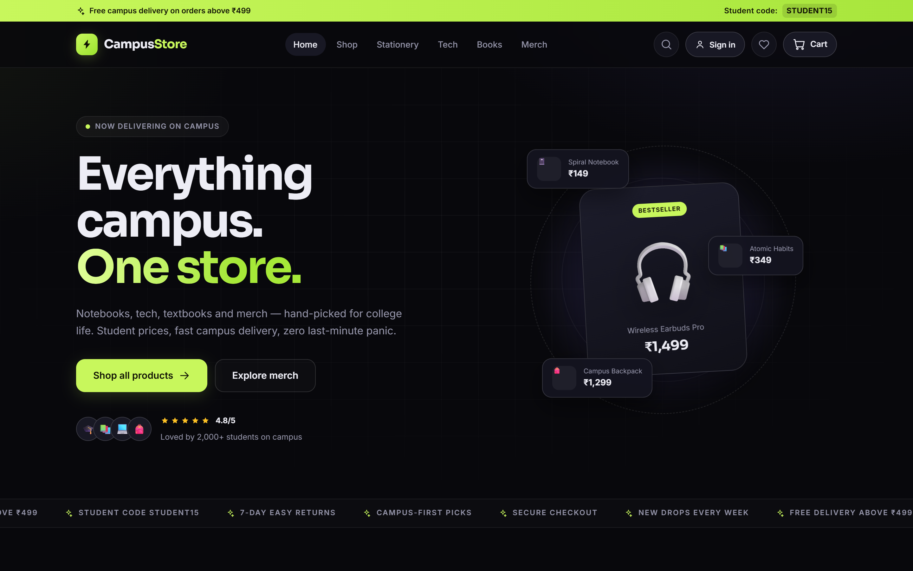
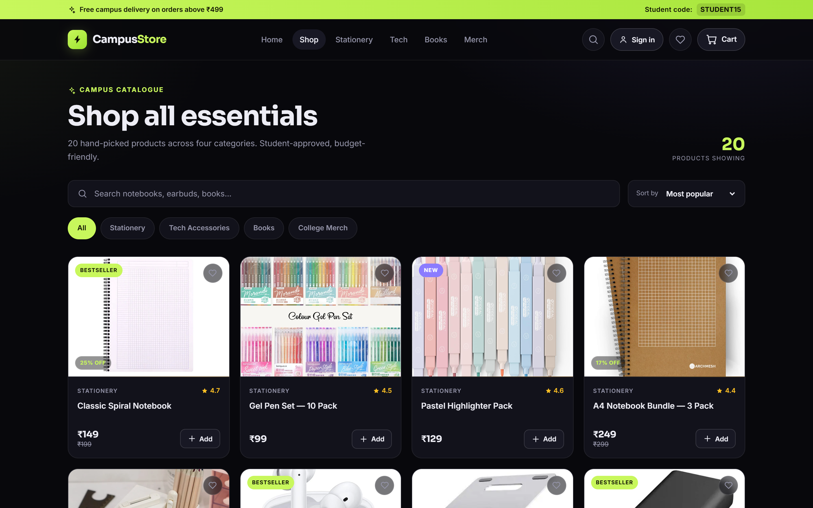
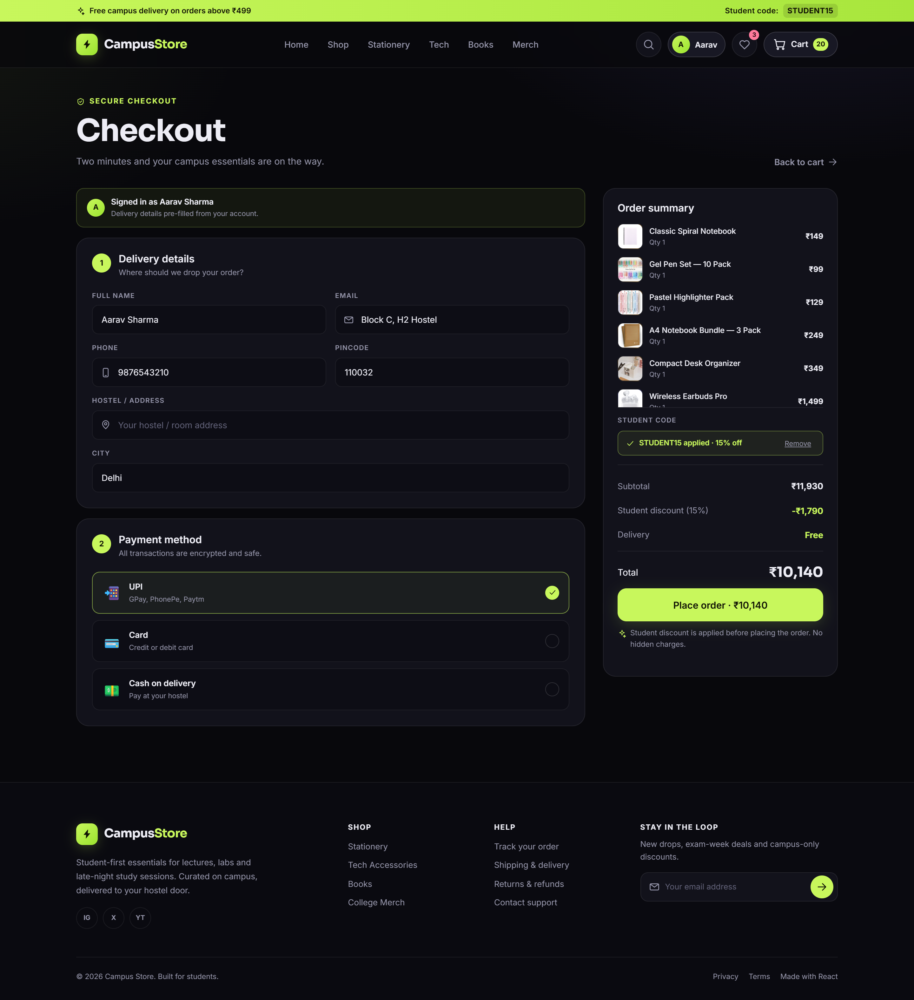
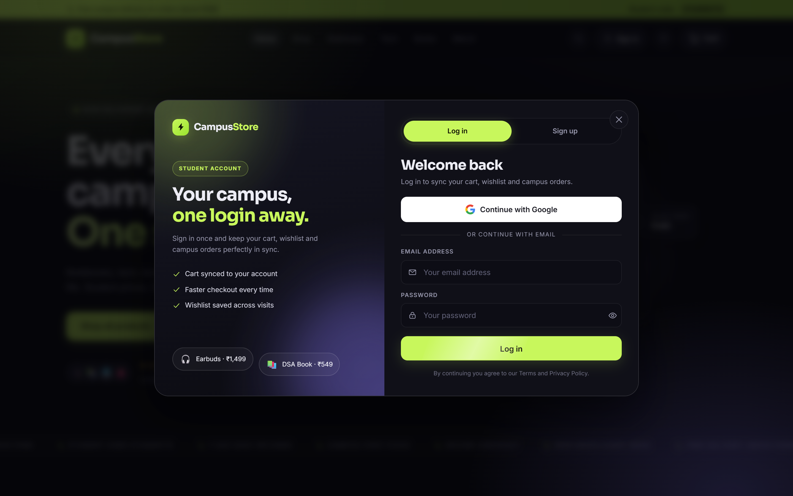
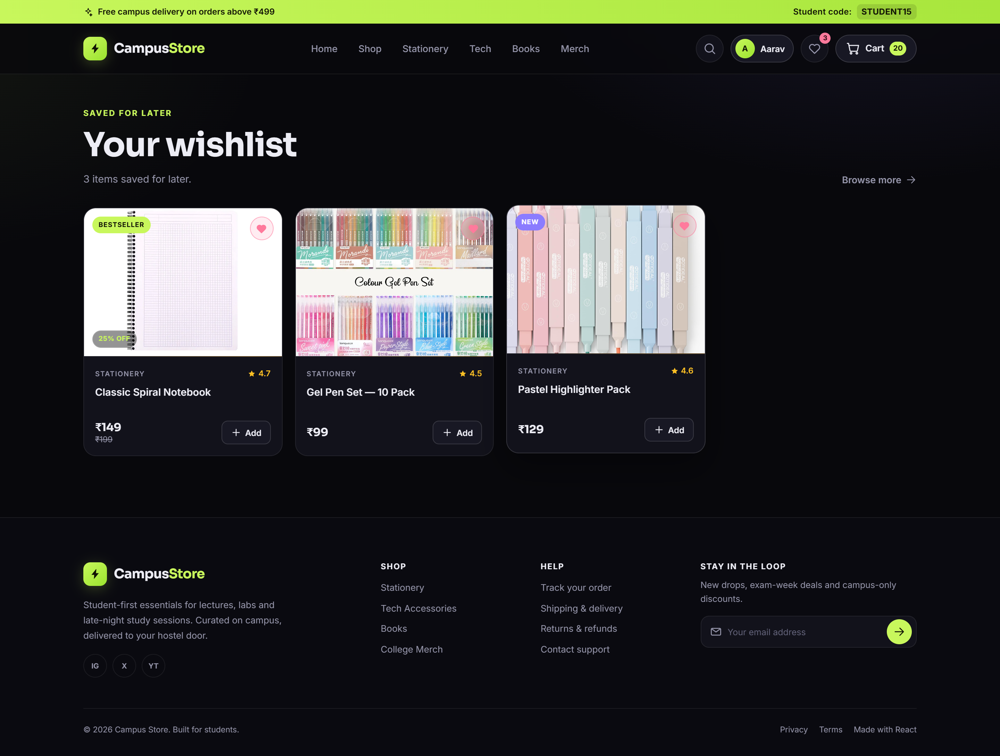
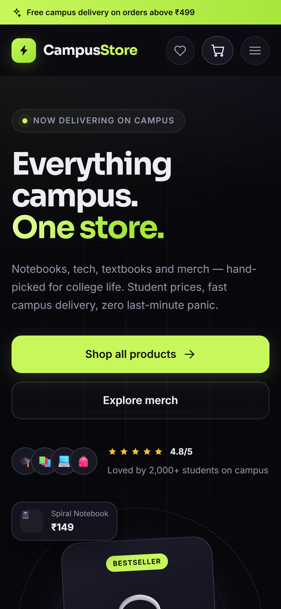
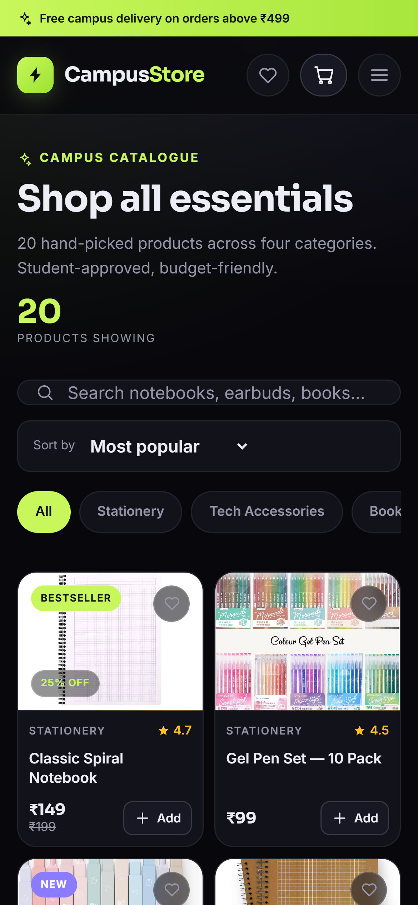
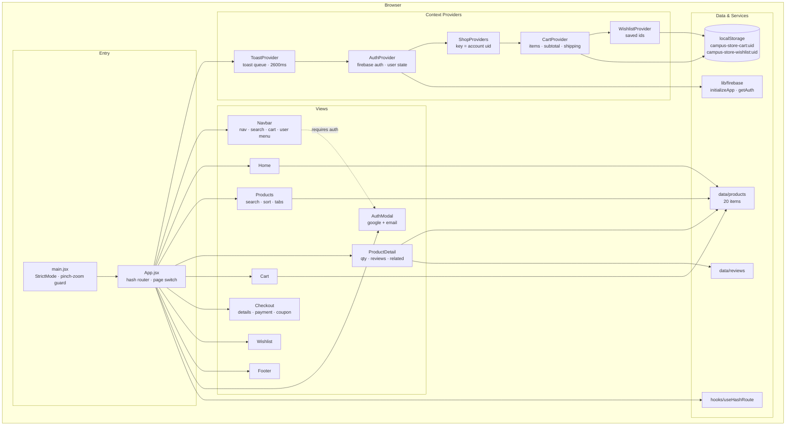
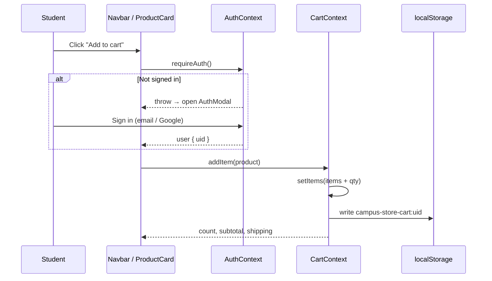
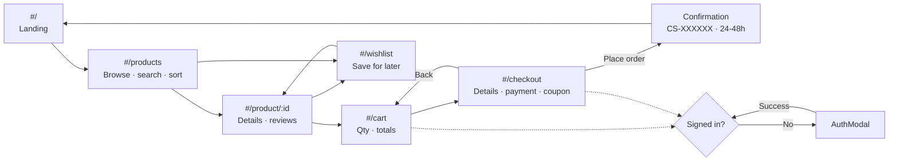

<div align="center">

# ⚡ Campus Store

**Everything campus. One shop.**

[](https://campus-storee.netlify.app)
[](https://app.netlify.com/projects/campus-storee)
[](https://react.dev)
[](https://vite.dev)
[](https://firebase.google.com)
[](LICENSE)

A student-first e-commerce storefront — stationery, tech, textbooks and college merch,
curated for campus life.

[🚀 Live Demo](https://campus-storee.netlify.app) · [🐛 Report Issue](https://github.com/shivamkumar0097/campus-store/issues) · [💬 Discussions](https://github.com/shivamkumar0097/campus-store/discussions)

</div>

---

## 📸 Screenshots

### Landing page



### Product catalogue — search, filter & sort



### Product detail with reviews


### Cart & checkout

| Cart | Checkout |
|:--:|:--:|
|  |  |

### Authentication & wishlist

| Sign in | Wishlist |
|:--:|:--:|
|  |  |

### Mobile

| Home | Catalogue |
|:--:|:--:|
|  |  |

---

## ✨ Features

| | Feature | Details |
|---|---|---|
| 🛍️ | **Catalogue** | 20 products across 4 categories — Stationery, Tech Accessories, Books, College Merch |
| 🔍 | **Live search** | Instant filter on product or category, with clear button |
| ↕️ | **Sorting** | Most popular · Price low→high · Price high→low · Top rated |
| 🗂️ | **Category tabs** | Deep-linkable via `?category=`, shareable URLs |
| 🛒 | **Cart** | Quantity stepper, remove, live subtotal + shipping logic |
| 🎁 | **Free delivery meter** | Progress bar nudging "add ₹X more for free campus delivery" (₹499+) |
| 💖 | **Wishlist** | Save any product in one tap, persisted per account |
| 🔐 | **Auth** | Email/password + Google login (Firebase Auth) |
| 🧾 | **Checkout** | Shipping details, UPI/Card/COD, coupon `STUDENT15` (15% off), order confirmation |
| 🔔 | **Toasts** | Custom toast system, `aria-live="polite"", auto-dismiss 2.6s |
| 📱 | **Responsive** | Mobile drawer nav, fluid grids, 16px fields (no iOS zoom) |
| ♿ | **Accessible** | Focus outlines, `prefers-reduced-motion`, ARIA roles on tabs/dialogs/toggles |
| 🌗 | **Dark theme** | Lime `#c8f75c` on `#08080c`, violet secondary, per-category accent tints |
| 🧭 | **Hash routing** | Zero-config static deploy — no server rewrite rules needed |

---

## 🛠️ Tech Stack

```
Frontend   React 19.3 · React DOM 19.3
Build      Vite 8.3 · @vitejs/plugin-react 6.1
Auth       Firebase 13.3 (Authentication only)
Routing    Custom hash router (no react-router)
State      React Context + useReducer-style providers
Styling    Hand-written CSS (custom properties, no framework)
Linting    ESLint 10 (flat config) + react-hooks + react-refresh
```

**Deliberately zero:** no UI library, no CSS framework, no state library, no router library,
no backend of its own. Everything is hand-rolled to keep the bundle at **~118 kB gzipped**.

---

## 🏗️ Architecture



### Account-scoped providers

The cart and wishlist providers are mounted with a **React `key` derived from the signed-in
UID**. Changing accounts remounts both providers, so state re-hydrates from the new
user's storage bucket — carts never leak between accounts.



### Shopping flow



---

## 🚀 Getting Started

### Prerequisites

- Node.js **18+**
- A free [Firebase](https://console.firebase.google.com) project (only for sign-in)

### 1. Clone & install

```bash
git clone https://github.com/shivamkumar0097/campus-store.git
cd campus-store
npm install
```

### 2. Configure Firebase

```bash
cp .env.example .env.local
```

Firebase Console → **Project settings** → **Your apps** → **Web app** → *SDK setup and
configuration* → paste the values into `.env.local`:

```env
VITE_FIREBASE_API_KEY=your_api_key
VITE_FIREBASE_AUTH_DOMAIN=your_project.firebaseapp.com
VITE_FIREBASE_PROJECT_ID=your_project_id
VITE_FIREBASE_STORAGE_BUCKET=your_project.firebasestorage.app
VITE_FIREBASE_MESSAGING_SENDER_ID=your_sender_id
VITE_FIREBASE_APP_ID=your_app_id
```

> **Tip:** the app works **without** Firebase — the catalogue, search, filters and product
> pages all function. Only sign-in, cart, wishlist and checkout are gated. The auth modal
> shows a *"Firebase setup needed"* banner when keys are missing.

### 3. Enable sign-in providers

In Firebase Console → **Authentication** → **Sign-in method**:

- ✅ **Email/Password**
- ✅ **Google** (add your deployment domain to *Authorized domains*)

### 4. Run it

```bash
npm run dev      # http://localhost:5173
npm run build    # production build → dist/
npm run preview  # preview the production build
npm run lint     # eslint
```

---

## 📁 Project Structure

```
campus-store/
├── public/
│   ├── favicon.svg
│   └── products/              # 20 product photos
├── src/
│   ├── components/
│   │   ├── AuthModal.jsx      # Split-panel sign in / sign up
│   │   ├── Footer.jsx
│   │   ├── Icons.jsx          # Inline SVG icon set
│   │   ├── Navbar.jsx
│   │   └── ProductCard.jsx
│   ├── context/
│   │   ├── AuthContext.jsx    # Firebase auth + friendly errors
│   │   ├── CartContext.jsx    # Items, totals, localStorage
│   │   ├── ToastContext.jsx   # Toast queue
│   │   └── WishlistContext.jsx
│   ├── data/
│   │   ├── products.js        # Catalogue seed
│   │   └── reviews.js         # Reviews per category
│   ├── hooks/
│   │   └── useHashRoute.js    # ~20-line hash router
│   ├── lib/
│   │   └── firebase.js        # init + graceful fallback
│   ├── pages/
│   │   ├── Cart.jsx
│   │   ├── Checkout.jsx
│   │   ├── Home.jsx
│   │   ├── ProductDetail.jsx
│   │   ├── Products.jsx
│   │   └── Wishlist.jsx
│   ├── App.css
│   ├── App.jsx
│   ├── index.css              # Design tokens
│   └── main.jsx
├── docs/screenshots/          # README assets
├── .env.example
└── vite.config.js
```

---

## 💡 Implementation Notes

**Persistence** — Cart and wishlist live in `localStorage`, keyed by the Firebase UID
(`campus-store-cart:<uid>`). Reads are `try/catch`-guarded and fall back to `[]` on
corrupt data. Nothing is written for signed-out users.

**Shipping rules** — flat ₹49, free when the cart is empty or subtotal ≥ ₹499.
`STUDENT15` applies a 15% discount to the subtotal, before shipping.

**Checkout** — a client-side simulation. No payment gateway is integrated; placing an
order generates a `CS-XXXXXX` reference, clears the cart and shows a confirmation screen.

**Hash routing** — all routes are `#/…`, so the built `dist/` folder can be dropped onto
GitHub Pages, Netlify or S3 with **no** SPA rewrite rule.

**Accessibility** — `role="tablist"` category tabs, `aria-pressed` toggles, `aria-modal`
auth dialog with Escape-to-close, `aria-live="polite"` toasts, visible focus rings, and a
global `prefers-reduced-motion` override.

**Responsive** — breakpoints at 1080px (grid columns), 900px (stacked layouts), 780px
(single-column auth modal), 680px and 420px (tightened spacing).

---

## 🚢 Deployment

### Netlify (live)

The site is deployed at **[campus-storee.netlify.app](https://campus-storee.netlify.app)**.

```bash
npm run build
netlify deploy --dir=dist --prod
```

### GitHub Pages

```bash
npm run build
# push dist/ to the gh-pages branch
```

### Environment variables

Set the six `VITE_FIREBASE_*` variables in your host's dashboard — the build inlines
them into the bundle.

---

## 📄 License

Released under the [MIT License](LICENSE).

<div align="center">
  <sub>Built with ⚡ by <a href="https://github.com/shivamkumar0097">Shivam Kumar</a> for students.</sub>
</div>
