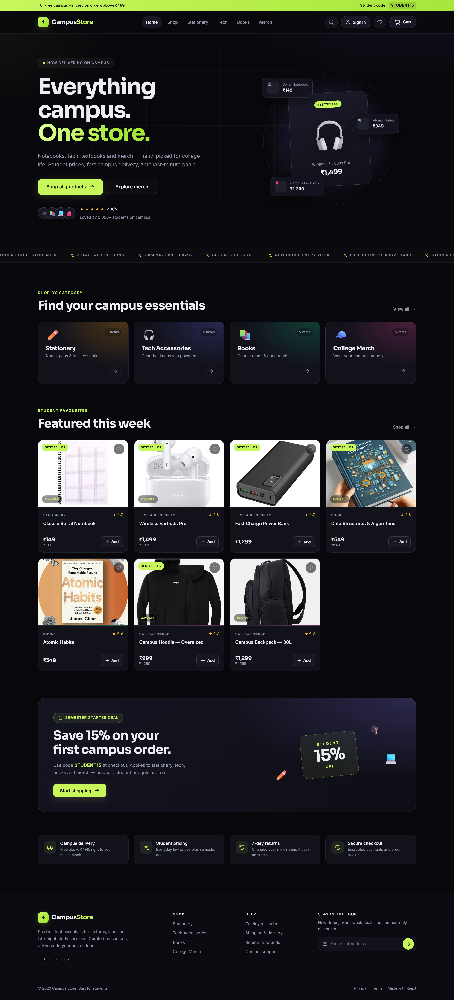
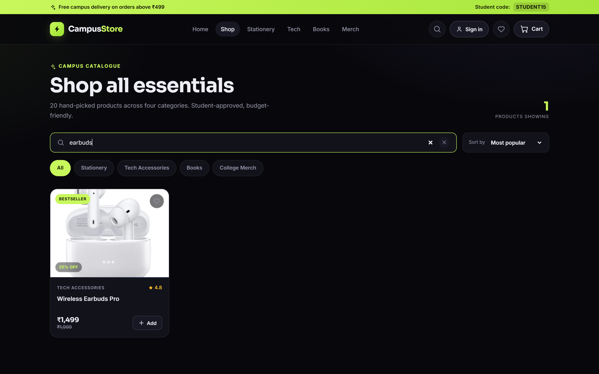
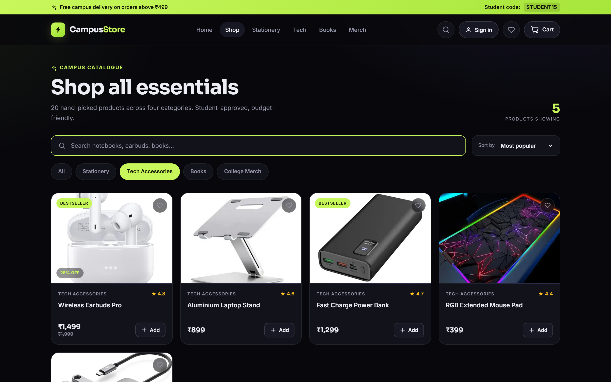
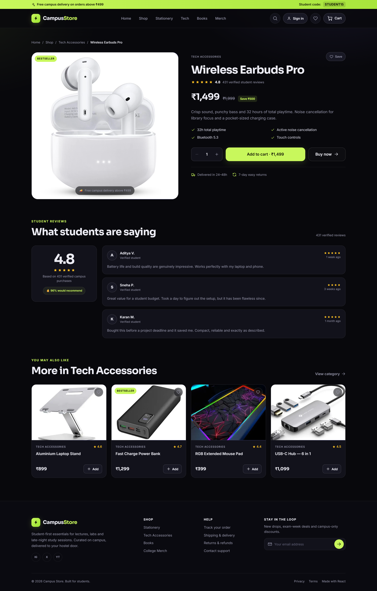
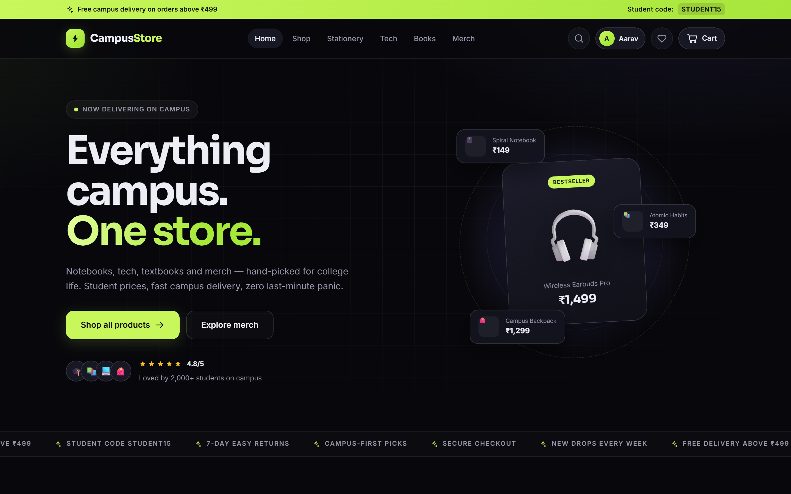
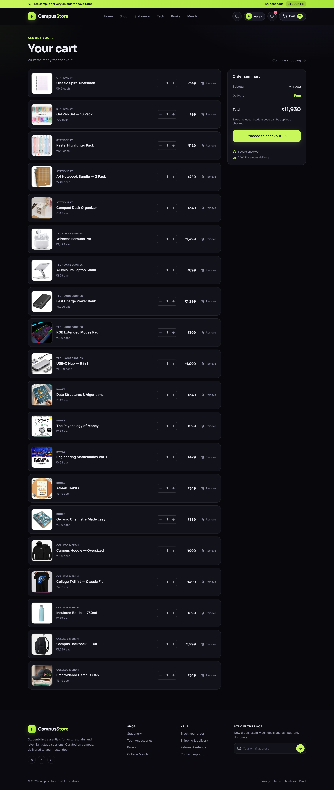
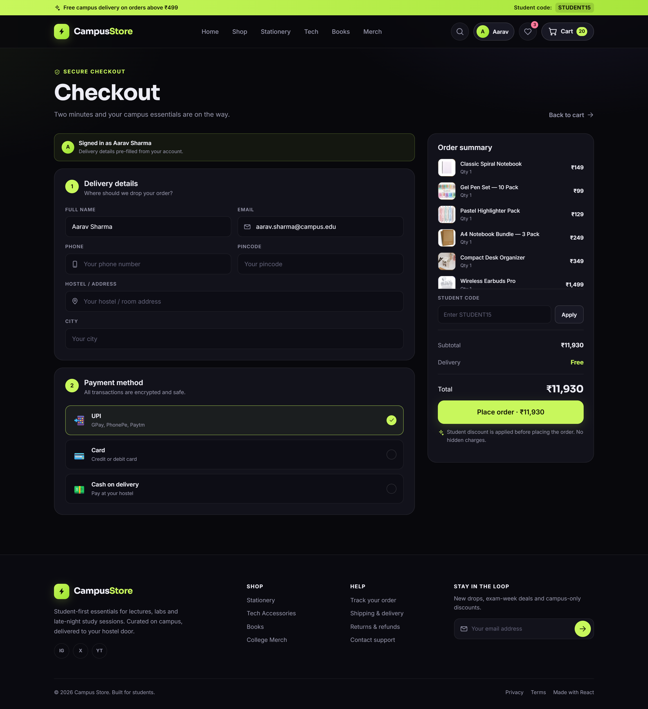
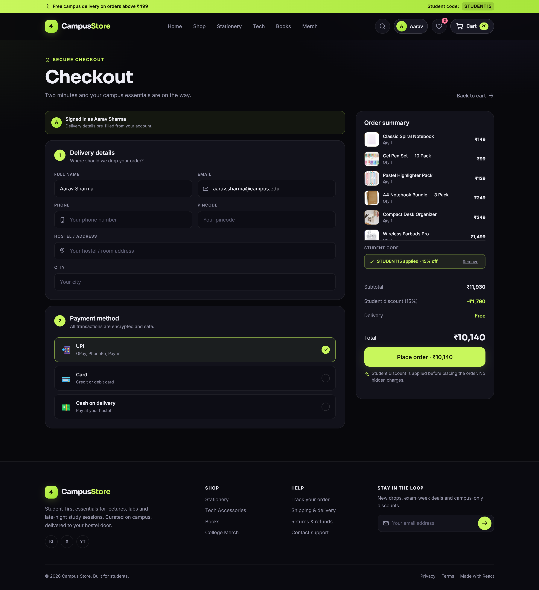
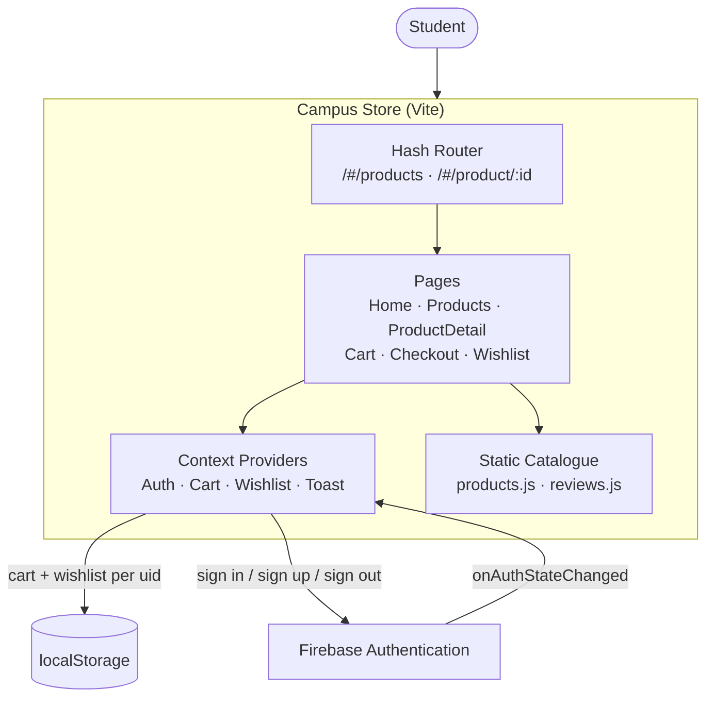
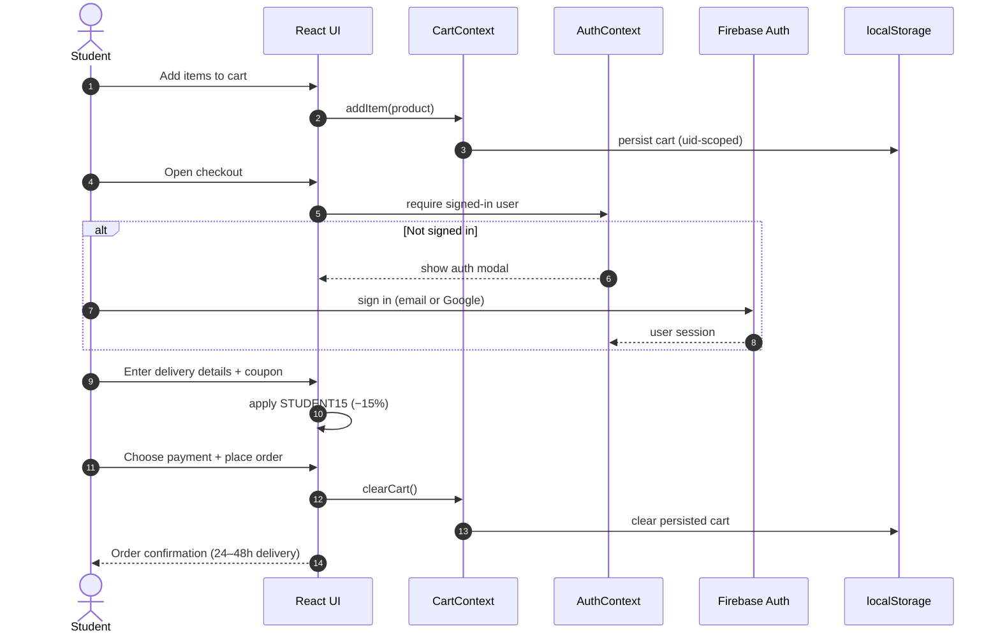

<div align="center">

# 🎓 Campus Store

**College essentials, one store.**  
A polished, student-first e-commerce experience built with React, Vite and Firebase.

[](https://react.dev/)
[](https://vite.dev/)
[](https://firebase.google.com/)
[](https://developer.mozilla.org/docs/Web/JavaScript)
[](https://eslint.org/)
[](https://github.com/shivamkumar0097/campus-store/pulls)

[](https://github.com/shivamkumar0097/campus-store/stargazers)
[](https://github.com/shivamkumar0097/campus-store/network/members)
[](https://github.com/shivamkumar0097/campus-store/commits/main)

</div>

---

## 🛍️ Overview

Campus Store is a single-page storefront for students — stationery, tech accessories, books and college merch in one place. It pairs a dark, high-contrast storefront with a real shopping flow: browse and filter the catalogue, open product pages with reviews and related items, save favourites to a wishlist, manage a cart, apply a student coupon and place an order.

Authentication is handled by Firebase (email/password + Google), while cart and wishlist state is persisted per-user in `localStorage` — so your bag follows your account, not your browser tab.

> 🎟️ Try coupon **`STUDENT15`** at checkout for 15% off.  
> 🚚 Delivery is **free over ₹499**.

---

## 📸 Screenshots

### Home & discovery

| Home hero | Full home page |
| --- | --- |
|  |  |

### Catalogue

| Browse | Search | Category filter |
| --- | --- | --- |
|  |  |  |

### Product & auth

| Product detail | Sign in / sign up | Signed in |
| --- | --- | --- |
|  |  |  |

### Cart, checkout & wishlist

| Cart | Checkout | Coupon applied |
| --- | --- | --- |
|  |  |  |

| Delivery details | Wishlist |
| --- | --- |
|  |  |

### Mobile

<p align="center">
  
  
</p>

---

## ✨ Features

- **🗂️ Four curated categories** — Stationery, Tech Accessories, Books and College Merch.
- **🔍 Fast catalogue** — instant search, category chips and sorting by popularity, price and rating.
- **📦 Rich product pages** — gallery-style hero, feature list, ratings, reviews, quantity picker and related products.
- **🔐 Firebase authentication** — email/password and Google sign-in, friendly error messages and a polished auth modal.
- **🛒 Persistent cart & wishlist** — scoped per Firebase user and stored in `localStorage`; guests are prompted to sign in.
- **🧾 Checkout flow** — delivery details, UPI / card / cash-on-delivery options, student coupon and order confirmation.
- **🎉 Toast notifications** — lightweight feedback for add-to-cart, wishlist and auth actions.
- **📱 Fully responsive** — sticky navigation, mobile drawer and layouts tuned for small screens.
- **♿ Accessible by default** — semantic landmarks, labelled controls, focus-visible states and reduced-motion support.

---

## 🏗️ Architecture



### Checkout flow



### Route map

| Route | Page | Purpose |
| --- | --- | --- |
| `/#/` | `Home` | Hero, categories, featured products, trust badges |
| `/#/products` | `Products` | Full catalogue with search, filters and sorting |
| `/#/product/:id` | `ProductDetail` | Product info, reviews, quantity, related items |
| `/#/cart` | `Cart` | Cart items, quantity controls, free-delivery progress |
| `/#/checkout` | `Checkout` | Delivery form, coupon, payment and confirmation |
| `/#/wishlist` | `Wishlist` | Saved products |

> Routing is hash-based (`useHashRoute`) so the app can be hosted on any static host without server rewrites.

---

## 🧰 Tech Stack

| Layer | Choice |
| --- | --- |
| UI | React 19 |
| Build tool | Vite 8 |
| Language | JavaScript (ES modules, JSX) |
| Auth | Firebase Authentication (`firebase/auth`) |
| State | React Context + `useReducer`/`useState` |
| Persistence | `localStorage` (per-user keys) |
| Styling | Hand-written CSS with design tokens (`App.css`, `index.css`) |
| Linting | ESLint 10 + React Hooks & Refresh plugins |
| Fonts | Inter + Sora (Google Fonts) |

---

## 🚀 Getting Started

### Prerequisites

- **Node.js 18+** and npm
- A **Firebase project** with **Email/Password** and **Google** sign-in enabled

### 1. Clone and install

```bash
git clone https://github.com/shivamkumar0097/campus-store.git
cd campus-store
npm install
```

### 2. Configure Firebase

Create `.env.local` from the template:

```bash
cp .env.example .env.local
```

Fill in the values from **Firebase Console → Project settings → Your apps → Web app**:

```env
VITE_FIREBASE_API_KEY=...
VITE_FIREBASE_AUTH_DOMAIN=...
VITE_FIREBASE_PROJECT_ID=...
VITE_FIREBASE_STORAGE_BUCKET=...
VITE_FIREBASE_MESSAGING_SENDER_ID=...
VITE_FIREBASE_APP_ID=...
```

### 3. Run

```bash
npm run dev
```

Open the printed URL (usually `http://localhost:5173`).

> Without Firebase keys the storefront still renders, but authentication actions will show a setup hint. Add the keys and restart the dev server.

### Available scripts

| Command | Description |
| --- | --- |
| `npm run dev` | Start the Vite dev server with HMR |
| `npm run build` | Build a production bundle into `dist/` |
| `npm run preview` | Preview the production build locally |
| `npm run lint` | Run ESLint across the project |

---

## 📁 Project Structure

```text
campus-store/
├── docs/
│   └── screenshots/          # README screenshots
├── public/
│   ├── favicon.svg
│   └── products/             # Product imagery
├── src/
│   ├── components/           # Navbar, Footer, AuthModal, ProductCard, Icons
│   ├── context/              # Auth, Cart, Wishlist and Toast providers
│   ├── data/                 # Catalogue (products.js) and reviews
│   ├── hooks/                # useHashRoute
│   ├── lib/                  # Firebase initialization
│   ├── pages/                # Home, Products, ProductDetail, Cart, Checkout, Wishlist
│   ├── App.jsx               # Providers + route switch
│   ├── App.css               # Component & layout styles
│   ├── index.css             # Design tokens & base styles
│   └── main.jsx              # Entry point
├── .env.example
├── index.html
├── package.json
└── vite.config.js
```

---

## 🧠 Implementation Notes

- **Per-user persistence** — `CartProvider` and `WishlistProvider` are keyed by the Firebase `uid`, so switching accounts swaps the cart/wishlist instantly while guests keep an empty bag.
- **No backend required** — products and reviews are static modules; only auth touches the network. This keeps the demo fast and easy to host on GitHub Pages, Netlify or Vercel.
- **Design system** — spacing, radii, shadows and color tokens live in `index.css`; components compose them in `App.css` with dark-mode-first styling.
- **Error handling** — Firebase error codes are translated into human-readable messages (wrong password, weak password, blocked popup, unauthorized domain, etc.).

---

## 🗺️ Roadmap

- [ ] Persist orders and profile data to Firestore
- [ ] Product search with fuzzy matching and price-range filters
- [ ] Product image galleries and zoom
- [ ] Admin dashboard for catalogue management
- [ ] Deployed live demo link

---

## 🤝 Contributing

Contributions are welcome!

1. Fork the repo and create a branch: `git checkout -b feature/my-feature`
2. Make your changes and run `npm run lint`
3. Commit with a clear message and open a pull request

If you find a bug or have an idea, open an [issue](https://github.com/shivamkumar0097/campus-store/issues).

---

<div align="center">

Built for students who’d rather shop between lectures than trek across campus. 🎒

[⬆ Back to top](#-campus-store)

</div>
